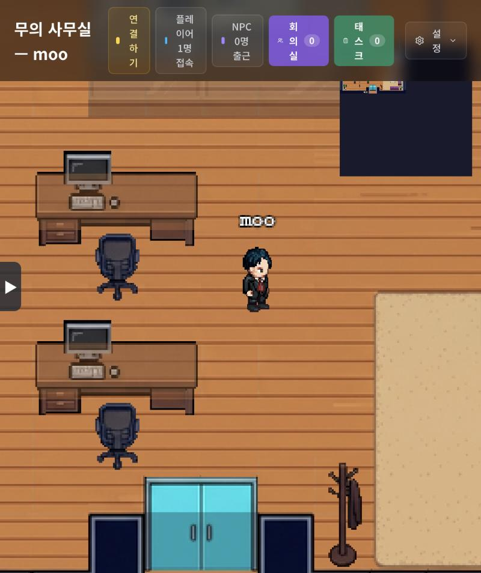

# 나만의 가상 사무실 — 2D 픽셀아트 + 로컬 AI 직원

[DeskRPG](https://github.com/dandacompany/deskrpg)의 **2D 픽셀아트 버전**을 한 대의 맥에 설치하고,
AI 직원을 **외부 API 키 없이 이 컴퓨터 안의 모델**(Ollama + [Hermes Agent](https://github.com/NousResearch/hermes-agent))로 돌리도록 구성한 기록과 스크립트입니다.

## 이 저장소가 담고 있는 것 / 담지 않은 것
- 담은 것: 시작·종료 스크립트, Hermes 연결 스크립트, AI 직원 성격 파일(SOUL), 설치 기록, 미리보기 화면.
- **담지 않은 것**: DeskRPG 원본 코드(라이선스 조건이 있어 원 저장소를 직접 받으세요), AI 모델 파일(약 9.5GB), 비밀 키(.env), 데이터베이스.
- **이 저장소 자체는 실행되는 웹사이트가 아닙니다.** 사무실은 서버와 로컬 AI가 있어야 하므로 GitHub에서 직접 돌릴 수 없고, 아래 소개 페이지와 설치 안내만 제공합니다.

## 파일 안내
- `시작하기.command` / `끄기.command`: 사무실·Hermes·Ollama를 한 번에 켜고 끄는 스크립트
- `연결스크립트.ts`: Hermes를 DeskRPG에 등록(토큰은 출력하지 않음)
- `hermes-SOUL.md`: AI 직원 성격 파일 / `설치기록.md`: 설치 과정과 문제 해결

## 구성
| 구성요소 | 역할 | 주소(이 컴퓨터에서만) |
|---|---|---|
| DeskRPG 2D (커밋 `16bb527c`, 2026.9.9) | 픽셀아트 사무실 화면 | http://localhost:3000 |
| Hermes Agent v0.22.5 | AI 직원의 두뇌(API 서버) | http://127.0.0.1:8642 |
| Ollama v0.40.13 + `gemma4:e4b` | 이 컴퓨터에서 도는 AI 모델 | http://127.0.0.1:11434 |

## 보안 원칙
- 세 서버 모두 `127.0.0.1`에만 열어 같은 네트워크의 다른 기기는 접속할 수 없습니다. DeskRPG는 첫 가입자가 관리자가 되므로 반드시 로컬 전용으로 여세요(`DESKRPG_BIND_HOST=127.0.0.1`).
- Hermes는 홈 폴더 대신 별도 폴더(`HERMES_HOME`)에 설치해 `~/.zshrc` 같은 개인 설정을 건드리지 않습니다.
- Hermes API 키는 직접 생성한 로컬용 키이며 저장소에 포함되지 않습니다.

## 알려진 한계
- 작은 로컬 모델(약 4B급)이라 긴 문서·복잡한 도구 작업은 품질이 불확실합니다. 인사·질문·간단한 정리는 무난합니다.
- DeskRPG용 Hermes 플러그인은 설치하지 않았습니다(칸반·크론 등 일부 기능 제한 가능).
- 메모리를 약 10GB 사용합니다(16GB RAM 맥에서 확인).

자세한 설치 과정과 문제 해결은 [설치기록.md](설치기록.md)를 보세요.
